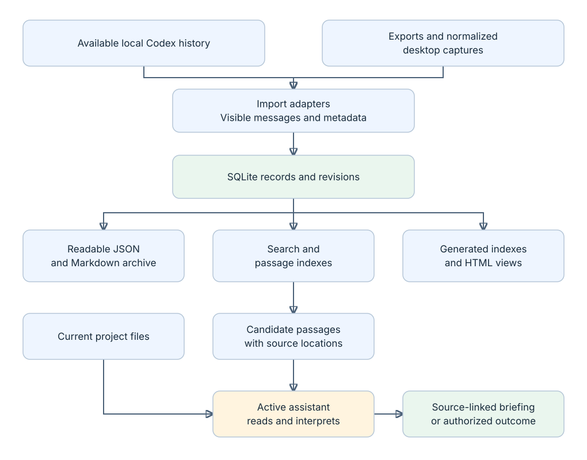
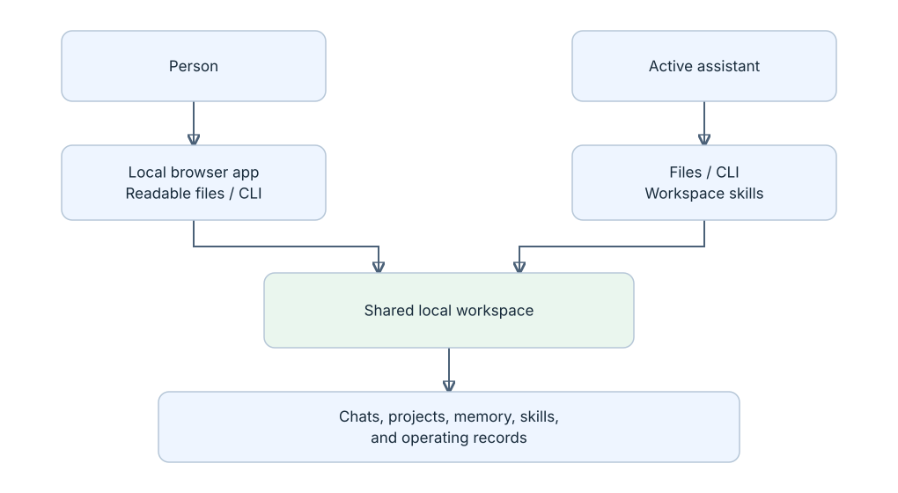

# How it works

The current application has a deterministic local core and an optional assistant workflow. Both use the visible workspace. The dedicated browser app uses a small standard-library local server over that same core.

The static SVG diagrams render without enabling Mermaid. Their editable [layout source](diagrams/render.py) uses only Python's standard library; run `python3 docs/diagrams/render.py` to regenerate them.

## From source messages to useful context

An assistant or user supplies desktop captures to an inbox before core sync imports them. The core does not log into ChatGPT, fetch every remote conversation, or ask a model to interpret decisions during ingestion.

## Two interfaces, shared records

The interfaces overlap: a person can run a CLI command, and an assistant can inspect the same Markdown record. There is no separate assistant-owned hidden archive in this design. Some original sources and live installed resources remain in their source applications; the workspace records their paths and available captured content.

## What a sync actually does

The implementation is in [runtime.py](../src/chatos/runtime.py).

1. **Acquire the workspace lock and start a run.** Record a run ID and time. An earlier unfinished running row is marked interrupted. Overlapping sync is refused.
2. **Discover and import available conversations.** Compare source fingerprints and retry incomplete sources. Codex source files and supported local metadata are read; export inbox files are parsed. Imports normalize visible messages and known metadata. Missing rollouts can have explicitly partial history-projection recovery.
3. **Update stored records.** Key conversations by source and ID. Changed records retain the previous database version. Write the JSON and Markdown representation and update the conversation search index. Unchanged input does not create another conversation.
4. **Collect operating evidence.** Read curated runtime-error evidence and local schedule metadata. Discover accessible skills and behavior files, compare hashes against the published snapshot, archive changes, and verify the result.
5. **Refresh derived outputs.** Refresh navigation, passage indexes, topic views, and map output. Optional pretrained model inference is not automatically run by sync. A saved experimental map can remain stale and is labeled accordingly.
6. **Verify the daily database backup and finish the report.** Persist errors, source coverage, timings, and change counts. Generate readable views. A failure in a later phase can coexist with earlier imported records; the run is not one all-or-nothing transaction.

Core sync does not call `file-projects`. External project-index delivery and substantive project filing are separate operations. This prevents a routine import from being described as automatic task execution.

## How a question becomes an answer

[retrieval.py](../src/chatos/retrieval.py) splits captured messages and selected workspace notes into overlapping passages, stores their source locations, and ranks query matches with SQLite full-text search. The command returns an evidence packet. It does not produce a model-written answer.

The [archive-retrieval skill](../workspace/chief_of_staff/skills/archive-retrieval/SKILL.md) tells an active assistant to inspect passages and neighboring turns, distinguish proposals from user instructions, check later evidence, and answer with links. The [project-briefing skill](../workspace/chief_of_staff/skills/project-briefing/SKILL.md) adds current project files when resuming work. This reasoning happens in the host assistant. Core import and default retrieval run locally; using an assistant is governed by that host's access and data handling. Local storage does not mean every assistant interaction runs offline.

Today, indexed workspace notes are working memory, current state, operating guidance, recorded chat-OS decisions, and local library annotations. The basic index does not search every document in every registered project. Reading those other project files is a separate assistant action.

## Storage and editing boundaries

| Location | Role | Editing rule |
| --- | --- | --- |
| `src/chatos/`, `scripts/`, `tests/` | Application implementation and checks | Developer changes |
| `workspace/your_ais/<source>/chats/YYYY/` | Generated JSON and Markdown conversation records | Use the library for local annotations; sync can replace generated files |
| `workspace/your_ais/<source>/annotations/` | Generated readable local titles, notes, archive state | Edit through the app/CLI; database is authoritative |
| `workspace/library/projects/`, generated topic/index files, HTML views | Derived navigation over captured records | Regenerated by the application |
| `workspace/app_data/state/` | SQLite records, revisions, checkpoints, reports, and indexes | Application-managed; the database includes durable state, not just cache |
| `workspace/your_ais/<source>/imports/` | Input export/capture files | Supply supported source files; ingestion is not a remote subscription |
| `workspace/backups/` | Database backups and manifests | Recovery material, currently on the same device |
| `workspace/app_data/snapshots/` | Dated behavior-file copies and hashes | Historical reference; not the live installed resources |
| Authored `workspace/chief_of_staff/reference/`, `workspace/library/topics/`, and project notes | Instructions, decisions, preferences, and explanations | Maintained records; distinguish these from generated files |
| `docs/`, README | Product and implementation explanation | Documentation; not application state or imported instructions |

The [Git ignore rules](../.gitignore) omit conversation payloads and runtime directories. Some authored records and configuration are tracked and currently contain personal information. A fresh clone is therefore not a sanitized multi-user starter. Keeping one workspace does not require publishing its private contents.

## Component map

| Responsibility | Main implementation |
| --- | --- |
| Local browser and annotations | [Server](../src/chatos/web.py), [library storage](../src/chatos/library.py), [static app](../src/chatos/static/index.html) |
| Commands and report display | [CLI](../src/chatos/__main__.py), [terminal reports](../src/chatos/terminal.py) |
| Records, routing candidates, revisions, and search | [core](../src/chatos/core.py) |
| Source parsing and desktop normalization | [importers](../src/chatos/importers.py), [desktop capture](../src/chatos/desktop_capture.py), [visibility filters](../src/chatos/visibility.py) |
| Sync, backup, change counts, and health | [runtime](../src/chatos/runtime.py), [changes](../src/chatos/changes.py), [recovery](../src/chatos/recovery.py) |
| Passage retrieval and optional semantic experiments | [retrieval](../src/chatos/retrieval.py), [semantic](../src/chatos/semantic.py), [dense](../src/chatos/dense.py), [dense map](../src/chatos/dense_map.py) |
| Browsing and map generation | [runtime views](../src/chatos/runtime.py), [explorer](../src/chatos/explorer.py), [HTML template](../src/chatos/templates/explorer.html) |
| Project delivery and reviewed ownership | [routing](../src/chatos/routing.py) |
| Operating-file inventory and snapshots | [inventory](../src/chatos/maintenance/system_inventory.py), [snapshot writer](../src/chatos/maintenance/snapshot_codex_state.py) |
| Schedules, errors, and feedback cues | [schedule evidence](../src/chatos/schedules.py), [native scheduler](../src/chatos/scheduler.py), [error collection](../src/chatos/maintenance/system_log.py), [feedback review](../src/chatos/feedback.py) |
| Assistant procedures | [assistant entry skill](../workspace/chief_of_staff/skills/chief-of-staff-entry/SKILL.md), [workspace instructions](../AGENTS.md) |

The supported hourly maintenance task belongs to the Codex host, outside the core Python runner. The native launch-agent implementation also exists, but this installation disabled it after Documents-folder access was blocked. Merely cloning the repository installs neither scheduler. Details and dated execution evidence belong in the [schedule record](../workspace/chief_of_staff/reference/Scheduled%20tasks.md).
